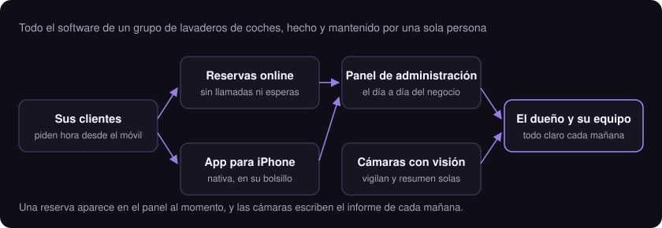

<h2>Qué puedo hacer por tu negocio</h2>

Soy desarrollador independiente. Hago el software que un negocio necesita para funcionar mejor, y me ocupo de todo: entender el problema, construirlo, ponerlo en marcha y mantenerlo.

<table>
  <tr>
    <td width="50%" valign="top">
      <h3>Software a medida</h3>
      Sistemas de reservas, paneles de administración y gestión interna hechos para cómo trabaja tu negocio, no al revés.
    </td>
    <td width="50%" valign="top">
      <h3>Automatización con IA</h3>
      Las tareas que alguien repite cada día (informes, avisos, pasar datos de un sitio a otro) se hacen solas.
    </td>
  </tr>
  <tr>
    <td width="50%" valign="top">
      <h3>Apps para iPhone</h3>
      Aplicaciones nativas para que tus clientes reserven, consulten o compren desde el móvil.
    </td>
    <td width="50%" valign="top">
      <h3>Visión por cámaras</h3>
      Tus cámaras dejan de solo grabar: detectan lo que pasa y te lo resumen en un informe.
    </td>
  </tr>
</table>

<h2>Un caso real</h2>

Para un grupo de lavaderos de coches he construido y mantengo todo su software: la app de reservas, el panel de administración, la aplicación de iPhone y un sistema de cámaras que vigila los coches y escribe un informe cada mañana.

Es software que se usa a diario en un negocio abierto al público, por eso el código es privado. Si quieres verlo funcionando, te lo enseño.

<h2>Cómo trabajo</h2>

<ul>
  <li><b>Hablas siempre con quien lo construye.</b> No hay comerciales ni intermediarios: la misma persona que escucha tu problema es la que lo resuelve y la que responde si algo falla.</li>
  <li><b>Trabajo con inteligencia artificial como copiloto.</b> Yo decido y reviso; la IA me quita el trabajo mecánico. Eso me deja dedicar el tiempo a tu problema.</li>
  <li><b>Lo que se repite, se automatiza.</b> Si en tu negocio alguien hace la misma tarea dos veces, lo normal es que acabe haciéndose sola.</li>
  <li><b>De principio a fin.</b> Diseño, programación, puesta en marcha y mantenimiento. No te entrego algo a medias para que otro lo termine.</li>
</ul>

<h2>Tecnología</h2>

JavaScript y TypeScript para aplicaciones web · Swift para iPhone · Python para visión por cámaras y automatización · Postgres para los datos · Claude Code como copiloto de IA.

Código abierto: <a href="https://github.com/PantherCode57/voice-studio-to-claude-skill">voice-studio-to-claude-skill</a>, una herramienta que convierte texto en audio con voces clonadas, en local.

<h2>Hablemos</h2>

Si en tu negocio hay algo que se sigue haciendo a mano, en papel o en una hoja de cálculo, cuéntamelo y te digo con sinceridad si se puede resolver con software y cómo.

<b><a href="https://github.com/PantherCode57">Contacta conmigo en GitHub</a></b>

